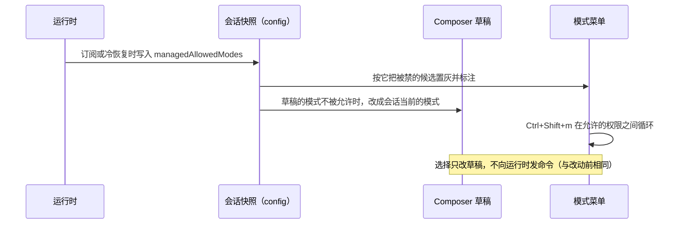

# 模式选择器里的受管限制

> 对应企业版改造点 T2。范围于 2026-11-24 由用户确定：“被策略禁掉的模式在模式选择器里不可选，并标明由组织管理”。运行时那部分（切换入口的拒绝、把被禁的模式写进会话快照）在 [`apps/zcode-cli/docs/design/v2/enterprise-managed-policy.md`](../../apps/zcode-cli/docs/design/v2/enterprise-managed-policy.md) 的“入口处与界面公布”一节。

## 行为

Composer 的模式菜单有两个部分：置顶的 Plan 勾选项，与其下方的三种权限（询问后修改、自主模式、完全访问）。组织的受管策略不允许其中某个模式时，对应的项**保留在菜单里，但不可选**，并写明“由组织管理”。

| 候选            | 受管策略不允许它时                                   |
| --------------- | ---------------------------------------------------- |
| Plan            | 勾选项置灰，不能勾选；说明文字换成“由组织管理”       |
| 三种权限中的任一 | 单选项置灰，不能选；说明文字换成“由组织管理”         |

- 鼠标点不动，键盘上下键跳过它。点被禁的“完全访问”不弹风险确认框，草稿不变。
- 循环权限的快捷键（`Ctrl+Shift+m`）只在允许的权限之间循环。
- 草稿里已经是被禁的模式时（比如“最近使用”记的是上次选的“完全访问”），界面一旦得知策略，就把草稿的模式改成会话当前的模式；开着被禁的 Plan 时把 Plan 关掉。因此不会带着被禁的模式发出去。
- 没有受管限制时，菜单、快捷键与草稿的行为与改动前一致，菜单里没有“由组织管理”字样。

“由组织管理”对应五种界面语言：中文“由组织管理”，英文 “Managed by your organization”，日文“組織により管理されています”，韩文"조직에서 관리함"，俄文“Управляется организацией”。

### 不在这里的范围

- 定时任务、闲时任务编辑器里的模式下拉，以及权限弹窗里的“放行并切换”。它们照旧列出全部模式；运行时在切换的地方拒绝，任务记录与弹窗里能看到原因。
- 终端界面的 `/mode` 列表与循环切换。
- 设置界面里一般配置项的只读。受管策略目前没有任何设置键。

## 事实从哪里来

“哪些模式被禁”只有一份：运行时把它写在会话快照的 `config.managedAllowedModes` 里，没有受管限制时没有这个字段。界面只读这一个字段，不读受管文件，也不另存一份。

- Composer 本来就从会话快照里读其它事实（Hook 与 MCP 的准入状态），这里沿用同一条路径。桌面的实时链路与手机的恢复链路读到的是同一份快照，不需要分别接线。
- 策略在创建会话时确定，每个会话各自带着它。界面不跨会话缓存。
- 没有绑定会话的新任务草稿，读的是预热会话的快照。
- 在新 worktree 里工作的草稿不预热，发送之前没有快照。这段时间菜单照旧显示；如果此时带着被禁的模式发送，运行时按回退模式执行（见运行时规格规则 3），快照到达后草稿被归正。



草稿的模式只是下一次提交的意图，选择时不向运行时发切换命令——这一点没有改。运行时在写入点的拒绝是另一道保障，针对的是不经过这个菜单的入口。

## 展示

- 被禁的项沿用下拉菜单的禁用样式：保留布局与层级，标题的文字变弱。不换图标，不改变各行的高度，菜单的宽度不变。
- “由组织管理”写在原来说明文字的位置（第二行），一直可见，用说明文字本来的颜色——不跟着标题一起弱化，因为用户最需要读懂的恰恰是这一句。禁用的行收不到悬停事件，所以原因不能只放在悬停提示里。
- 第二行的宽度有限（菜单固定 256 像素），文案要放得下，放不下时换行而不是截断。
- 浅色与深色主题都要能分清“弱化的文字”和“正常的文字”。置灰的项不靠颜色单独表达：它同时有禁用的语义属性（`aria-disabled`）和可见的文字。

## 验收

用真实浏览器驱动真实的 `V4ComposerModeSwitch`（`packages/ui/test/browser/manual-review/pending/managed-mode-selector.test.mjs`）：

1. 没有受管限制：四个候选都能选，菜单里没有“由组织管理”。
2. `managedAllowedModes = ["build", "plan"]`：自主模式与完全访问两项带 `aria-disabled="true"` 与标注；点击后草稿不变，也不弹风险确认框；询问后修改与 Plan 照常可选。
3. `managedAllowedModes = ["build", "guarded"]`：Plan 勾选项置灰并标注，勾选不改变草稿。
4. 循环快捷键在允许的权限之间循环，不经过被禁的权限；只有一种权限可选时快捷键不切到被禁的权限。
5. 面板块（`useManagedModePolicy`）：得知策略后，草稿里被禁的模式改成会话当前的模式，开着的被禁的 Plan 关掉；对被禁模式的切换被放弃；别的会话的快照不改变这份草稿；没有限制时草稿不动、切换照常放行。
6. 上述表现覆盖五种语言、浅色与深色主题、390 与 1200 两种宽度，标注可见且不横向溢出。

### 桌面 E2E 没有覆盖这一项

仓库的桌面 E2E 跑的是真实的 Agent 和真实的受管文件位置。那个位置要管理员权限才能写入，而 E2E 配置又明确禁用了自定义的 Agent 命令（`packages/desktop/wdio.conf.ts` 的 `configureZCodeAgentServerEnv`），所以没有办法在 E2E 里给应用一份策略。按规格的设计，也不为测试开环境变量或命令行开关的口子。运行时那一侧由 CLI 测试覆盖（真实应用加 `managedConfigPath`），整体链路靠下面的人工验证。

## 人工验证

需要管理员权限。运行时规格末尾的 CLI 步骤用的是同一份受管文件。

```bash
# 1. 放一份禁用 WebFetch、只允许 build 与 plan 的受管文件（macOS）
sudo mkdir -p "/Library/Application Support/ZCode"
printf '%s\n' '{"version":1,"permission":{"disallowedTools":["WebFetch"],"allowedModes":["build","plan"]}}' \
  | sudo tee "/Library/Application Support/ZCode/managed-config.json"

# 2. 启动桌面版，打开任意项目的新任务，展开模式菜单：
#    “自主模式”和“完全访问”置灰，写着“由组织管理”；Plan 与“询问后修改”可选。
# 3. 按 Ctrl+Shift+m：模式不变化（只有“询问后修改”一种权限可选）。
# 4. 发一条消息让模型抓取网页：应当被拒绝，提示它被组织的策略禁用。
# 5. 打开一个定时任务，模式选“完全访问”并保存：保存不拦；运行时这条任务失败并写明原因。
# 6. 验证完移除受管文件，重启应用，确认菜单恢复四个候选。
sudo rm "/Library/Application Support/ZCode/managed-config.json"
```

## 验证记录（2026-11-24）

环境：macOS，Node 24.14.0，系统 Chrome；上游 `a4b44451` 加 T1、T3 的三个提交与本次改动。尚未执行。

已执行的自动化验证：

- `node --test packages/ui/test/browser/manual-review/pending/managed-mode-selector.test.mjs`：9 个场景全部通过（第 6 条每个组合内部覆盖五种语言）。
- 上面第 2 到第 6 条的七个场景写在实现之前，实现之前全部失败，实现之后全部通过。第 1 条（不受限）在实现之前没能跑通——脚本里的地址少了一个问号，修正它的时候实现已经写进去了；不受限时菜单的现状另由既有的 `yolo-confirmation.test.mjs` 覆盖。第 5 条（面板块）的场景写在实现之后，没有经历“先失败”这一步；那个文件的初稿里有一处错误（不受限时把所有切换都拦掉了），是写这个场景时发现并改掉的。
- 回归：既有的 `yolo-confirmation.test.mjs` 8 个场景全部通过，它覆盖不受限时菜单的选择、风险确认与快捷键循环。
- 截图在 `packages/desktop/.e2e-artifacts/managed-mode-selector-browser/`（不入库）。
